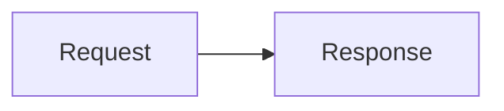

# Rendering Markdown to HTML and PDF

```sh
md-doc-converter md-to-html docs/spec.md   # docs/spec.html
md-doc-converter md-to-pdf docs            # docs/docs.pdf, from every page in docs/
```

`md-to-html` and `md-to-pdf` render one Markdown file, or a folder of Markdown
files, and `--help` lists each command's options. Rendering needs Node.js and
the toolchain that `md-doc-converter setup` installs, including Pandoc;
`md-doc-converter doctor` checks all of them, and a render that is missing one
fails before it writes anything.

## Output

Each render writes one file:

| Input | Default output |
| --- | --- |
| `docs/spec.md` | `docs/spec.html` or `docs/spec.pdf` |
| `docs/` (a folder) | `docs/docs.html` or `docs/docs.pdf`, inside the folder |
| `.` | `<current folder name>.html` or `.pdf`, in the current folder |

A file input is named without its final extension; a folder input keeps its
complete name, including dots. Spaces and Unicode are preserved. `-o` selects
another file and creates its folder if needed; it must end in `.html` or
`.htm` for HTML and `.pdf` for PDF:

```sh
md-doc-converter md-to-pdf docs/spec.md -o "reviews/spec review.pdf"
```

An existing output is replaced in one step, and only after rendering succeeds:
a failed render leaves the previous file untouched. Rendering refuses an output
that is the input, the extra stylesheet, a symlink or a directory.

The source Markdown and its images are never changed, and no public
intermediate files are written. The prepared document, generated styles and,
for a PDF, the staged HTML stay in a private temporary directory that is
removed after the render. To inspect them, keep them in a new or empty
directory; they are kept even when rendering fails. The prepared document is
the Markdown as parsed and prepared, in Pandoc's JSON format, which Pandoc then
reads. In it, each embedded image's data is a short placeholder, which the HTML
replaces with the data:

```sh
md-doc-converter md-to-pdf docs/spec.md --keep-intermediates spec-render
```

The HTML is self-contained: it embeds its images, the GitHub Markdown
stylesheet and, for a document with math, KaTeX's stylesheet and fonts. It
opens anywhere without a network, and printing it to PDF needs none either.
Links to other local files point to their absolute paths on the machine that
rendered them, on Windows as `/C:/...`, as a `file:` URL names them.

## Messages

Rendering warns about what it cannot show as written, such as a missing image
or a link to a heading that does not exist:

```text
md-to-html: rendering docs
md-to-html: warning: docs/setup.md: broken anchor '#instal' (no matching heading)
md-to-html: warning: docs/notes.md:12: Duplicate note reference '1'
rendered docs -> docs/docs.html
```

`--verbose` also lists the files that a folder render reads, and what
preparing them changed, such as the wiki macro lines it dropped. See
[Messages](../README.md#messages) for the options that choose what is shown.

## Folder input

A folder is collected recursively into one document. A folder laid out as an
Azure DevOps Wiki keeps the wiki's order: a `.order` file lists a folder's
entries one per line, as Markdown file names without `.md` or as subfolder
names, and unlisted entries follow, sorted by name. A `topic.md` beside a
`topic/` folder is the title page for that folder's pages and is placed with
them. Without `.order`, entries are sorted by name, except that the first
Markdown file leads when the folder has no title page. Entries whose names
begin with `.` are skipped.

When the folder is inside a Git work tree, Git-ignored files are skipped.
`--no-respect-gitignore` includes them; `--respect-gitignore` requests
filtering explicitly and warns when it has no effect.

## How Markdown is read

Rendering reads Markdown with Pandoc, and prepares it so that Pandoc reads it
as GitHub shows it:

- Heading IDs are GitHub's, the same that Word conversion writes. In a folder,
  links between files lead to the right heading of the combined document, even
  among repeated headings; a link to a heading that does not exist is reported.
- Each file's link references, footnotes and lists are its own: a label used in
  two files keeps each file's definition, and a list that ends one file does not
  continue into the next.
- A code block's language is the first word of its info string, so
  `` ```python title="x.py" `` opens a Python code block.
- GitHub's math syntax works; see [Math](#math).
- In a table cell, an escaped pipe in code, `` `a\|b` ``, is a pipe. A
  block-level HTML tag such as `<ul>` in a cell is reported with its line,
  because Pandoc drops the rest of the cell; write the cell's lines with
  `<br>`, or make the table HTML.
- Azure DevOps Wiki's `[[_TOC_]]` and `[[_TOSP_]]` macro lines are dropped.

Unlike GitHub, bit-field notation that would define a link reference, such as
`[1:0]: Mode` at the start of a line, renders as text.

## Images and documents from elsewhere

Rendering embeds the image files that a document shows from inside its Git
repository or, outside Git, from the folder that holds the input: the file's
folder, or a folder input's parent, where its title page and Word images are.
It reads no other file and, without `--download-images`, downloads nothing that
a document names, so a document from elsewhere cannot copy your files, such as
SSH keys, into its HTML or PDF, nor tell its author when and where it was
rendered. Any other image stays a reference, with a warning: the HTML loads it
when it is opened, and the PDF is printed without it.

`--download-images` downloads and embeds the images that a document shows by
http(s) URL, so that the PDF shows them too. One that cannot be downloaded, or
is not an image, stays a reference, with a warning that says why. Use it only
for documents you trust: it lets a document make rendering request any URL,
including addresses inside your network.

Rendered HTML runs no script: its content security policy allows none. The PDF
is printed with JavaScript off, and the browser loads nothing but the HTML.

## Mermaid diagrams

Each `mermaid` code block becomes an image of its diagram, drawn by
[mermaid-cli](https://github.com/mermaid-js/mermaid-cli) in one run for the
whole render and embedded in the HTML. Diagrams use Mermaid's defaults, such as
the ELK layout for flowcharts and state, class and ER diagrams, except that
their labels use the text's sans-serif fonts, so that a PDF's diagram text can
be found and copied. A diagram can choose others in its front matter, for
example the dagre layout of earlier Mermaid versions, or another font with
`fontFamily`:

````markdown

````

Diagrams are shown at 75% of their natural size, and no wider than the page. A
diagram that Mermaid cannot draw stops the render with Mermaid's message and
the diagram's position, such as `Mermaid diagram 2 of 3 (flowchart LR)`.

A diagram's alt text, which screen readers read and the PDF keeps, is its
accessible title and description, given with `accTitle` and `accDescr`; or else
the title in its front matter; or else its type, such as `Flowchart`:

````markdown

````

`accDescr { ... }` holds a description over several lines.

## Math

TeX math between `$` signs, or between `$$` for display math, is rendered with
[KaTeX](https://katex.org/). GitHub's forms work too: `` $`...`$ `` for inline
math, a code block whose language is `math` for display math, and `\\{` and
`\\}` for braces in inline math. Math that KaTeX cannot parse is shown as its
TeX source in red, with KaTeX's message as its tooltip, rather than stopping the
render.

## Page header and footer

PDF pages show page numbers, centered at the bottom as `Page N of M`. Header and
footer text is optional and empty by default:

```sh
md-doc-converter md-to-pdf docs/spec.md --header "Design review" --footer "Draft"
```

The header appears at the top right and the footer at the bottom left, in
8-point gray text. `MD_DOC_CONVERTER_HEADER` and `MD_DOC_CONVERTER_FOOTER` set
defaults; the options override them, and an empty option, such as `--header=`,
clears a default.

The text is literal, never CSS or HTML, and is escaped safely. Quote it for the
shell, using single quotes when it contains `$` or other shell-special
characters, in bash and PowerShell alike. Headers, footers, and page numbers use
the body's sans-serif font stack; code keeps its monospace stack.

Page-margin rules affect only PDF output. The header uses the `@top-right`
margin box, the footer `@bottom-left`, and the page number `@bottom-center`.
See [margin at-rules](https://developer.mozilla.org/en-US/docs/Web/CSS/Reference/At-rules/@page#margin_at-rules)
for the other boxes, and the `counter(page)` and `counter(pages)` values, which
an extra stylesheet can use.

## Extra stylesheet

`--extra-css FILE` applies a stylesheet after the shared styles and the header
and footer, for additional branding or layout. It is inlined into the HTML, so
it must not contain `</style`. Files it references with `url()`, such as fonts
or a logo, are embedded: paths, absolute or relative to the stylesheet, and
URLs, which are downloaded. Keep content other than tables within the page
width: when anything is wider, Chrome shrinks every page of the PDF to fit it.
A table wider than the page is printed smaller instead, as
[Table styling](#table-styling) describes; the page size and margins that the
stylesheet's `@page` rules give count.

The shared styles provide:

- US Letter pages with one-inch margins;
- page numbering and the optional header and footer text;
- headings kept on the page of the text they introduce;
- text and monospace font stacks of fonts that Linux and Windows have;
- image, table, code-block, and page-width overflow protection;
- Mermaid diagram scaling;
- reusable compact and fixed-width table classes.

## PDF time limit

Each browser step of a PDF render (loading the page, then printing it) may take
up to 600 seconds by default. Large folder renders on busy hosts can need more.
Set `--pdf-timeout` to a larger whole number of seconds, or to `0` to remove the
limit; `MD_DOC_CONVERTER_PDF_TIMEOUT` sets a default:

```sh
md-doc-converter md-to-pdf docs --pdf-timeout 1800
md-doc-converter md-to-pdf docs --pdf-timeout 0
```

A step that exceeds the limit fails the render with a message naming the
setting, and any previous output is left unchanged. HTML rendering does not use
the limit.

## Table styling

In a PDF, a table wider than the page, such as one whose columns hold long
identifiers that cannot wrap, is printed smaller to fit the page, down to half
its size; one still too wide then breaks its words wherever it must. The rest
of the document keeps its size.

Wrap a Markdown table in a classed `div` when it needs tighter PDF layout.
Blank lines before and after the table are required.

| Class | Effect |
| --- | --- |
| `table-sm` | 85% font size |
| `table-xs` | 75% font size |
| `table-compact` | Reduced cell padding |
| `table-fixed` | Equal-width columns |
| `table-cols` | Widths controlled by `--col1` through `--col6` |

Classes can be combined. For wide tables, start with `table-sm table-compact`
for about five or six columns and `table-xs table-compact` for seven or more.
Add `table-fixed` for equal-width columns, or use `table-cols` to size
individual columns.

Example:

```markdown
<div class="table-sm table-compact">

| Signal | Bits | Description |
| --- | --- | --- |
| example | [7:0] | Example value |

</div>
```

Explicit widths:

```markdown
<div class="table-cols" style="--col1: 20%; --col3: 60%">

| Signal | Bits | Description |
| --- | --- | --- |
| example | [7:0] | Example value |

</div>
```

Markdown tables cannot span columns. Use a raw HTML table inside the wrapper
when cells must span columns; the classes apply to it in the same way:

```markdown
<div class="table-xs table-compact">

<table>
<tr>
  <th>Manager</th>
  <th>Bit 3</th><th>Bit 2</th><th>Bit 1</th><th>Bit 0</th>
</tr>
<tr>
  <td>FOO</td>
  <td>0</td>
  <td colspan="3">some_signal[2:0]</td>
</tr>
</table>

</div>
```

## Reviewing a render

Review the generated PDF for wide tables, diagram sizing, links, page breaks,
the header and footer, and page numbering. The table classes above can tighten
layout without changing the source data.
